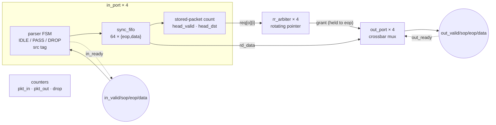
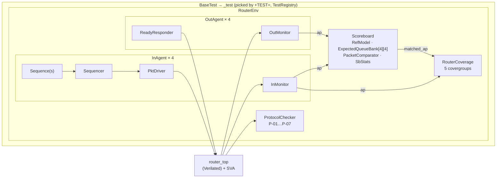
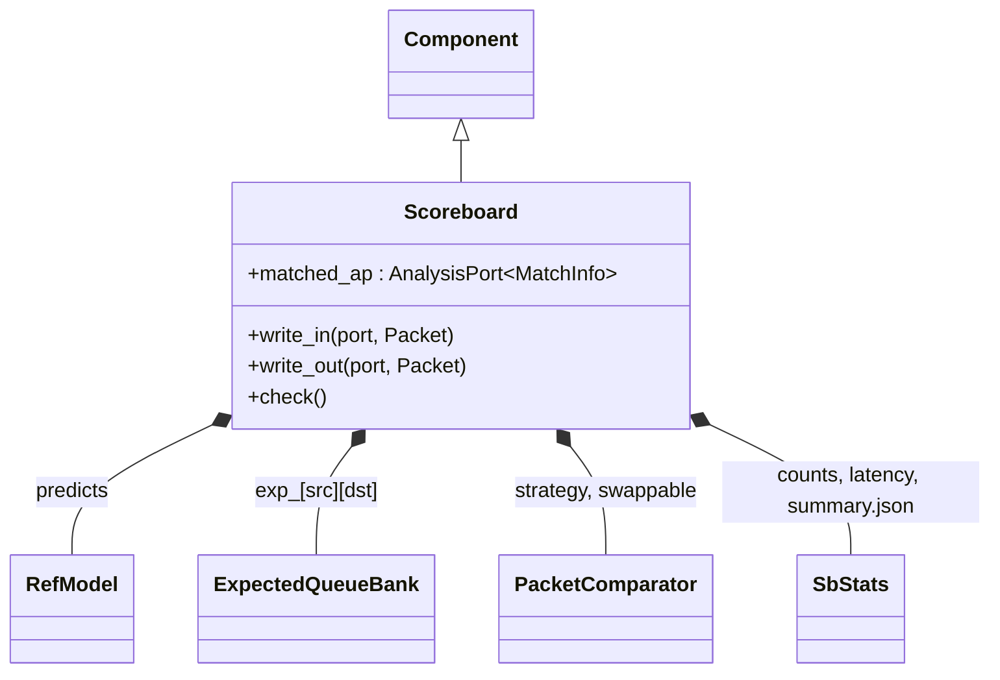
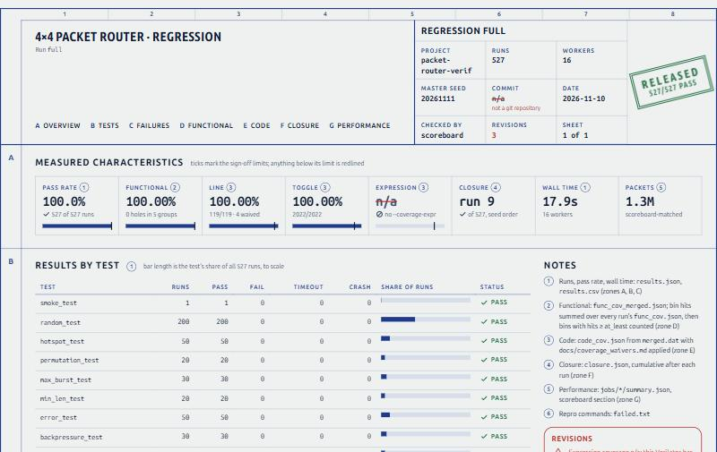
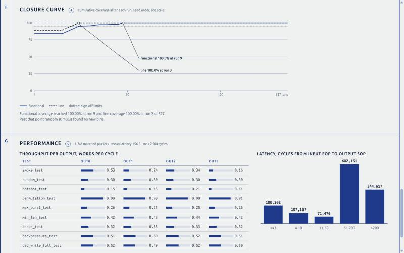

# packet-router-verif

A 4×4 store-and-forward packet router in SystemVerilog, verified by a UVM-style
testbench written in C++17 on Verilator, and driven by a Python regression pipeline
that compiles once, runs hundreds of seeds in parallel, merges functional and code
coverage, buckets failures and publishes an offline HTML dashboard. The design is
deliberately small; the testbench and the automation are the product.

**Live dashboard:** [full regression, 527 runs](https://lecrupus.github.io/packet-router-verif/full/dashboard/)
· [a failing run with an injected RTL bug](https://lecrupus.github.io/packet-router-verif/bug_src_tag/dashboard/)
· [code-coverage report](https://lecrupus.github.io/packet-router-verif/full/code_cov_html/)

## The design under test

Packets (1 header word + 1–31 payload words) enter on 4 input ports, wait in a 64-word
FIFO per input until their `eop` arrives (store-and-forward), then compete for their
output through a round-robin arbiter that holds the grant until `eop`. `in_ready` and
`out_ready` carry backpressure in both directions; bad-length packets are dropped at the
input and counted.



| Parameter | Value |
|-----------|-------|
| `N_PORTS` | 4 |
| `DATA_W` | 32 |
| `MAX_LEN` | 31 payload words |
| `FIFO_DEPTH` | 64 words per input |
| `CNT_W` | 16 (wrapping) |

Header: `[7:0] len`, `[9:8] dst`, `[11:10] src_tag` (router writes the ingress port),
`[15:12] reserved`, `[31:16] flow_id`. Measured: header leaves 2 cycles after `eop` is
written to an idle output; back-to-back packets on one output have exactly 1 idle cycle;
1 word/cycle within a packet.

Files: `rtl/router_pkg.sv`, `sync_fifo.sv`, `in_port.sv`, `rr_arbiter.sv`, `out_port.sv`,
`router_top.sv`; assertions A-01…A-06 in `rtl/sva/router_sva.sv`, attached with `bind`
in `rtl/sva/bind_router.sv` so the RTL carries no verification code.

## Testbench architecture



`Sim` owns the Verilator model and runs every cycle in a fixed order: drivers `drive()`
→ `eval()` → drivers `post_eval()` (was my word accepted?) → monitors / checker /
coverage `sample()` → rising edge. Monitors therefore see exactly the transfers the DUT
sees, and never drive; drivers never check.

### C++ class → UVM map

| C++ class | Derives from | UVM equivalent | Job |
|-----------|--------------|----------------|-----|
| `Object` | — | `uvm_object` | name, `to_string()`, `clone()` |
| `Packet` | `SeqItem` ← `Object` | `uvm_sequence_item` | header fields + payload, `randomize()`, `compare()` |
| `Sequence<T>` | `Object` | `uvm_sequence` | stream of items with a traffic pattern |
| `Component` | — | `uvm_component` | parent/child tree (`unique_ptr`), phases `build → connect → run_cycle → check → report` |
| `Sequencer<T>` | `Component` | `uvm_sequencer` | queues sequences, hands the driver one item on request |
| `PktDriver` | `Driver<Packet>` ← `Component` | `uvm_driver` | packet → `valid/sop/eop/data`, obeys `in_ready`, gaps and bubbles |
| `ReadyResponder` | `Component` | reactive driver | `out_ready` patterns ALWAYS / RANDOM / BURSTY / HOLD_THEN_RELEASE |
| `InMonitor` / `OutMonitor` | `Monitor<Packet>` ← `Component` | `uvm_monitor` | rebuild packets from transfers, publish on `ap` |
| `AnalysisPort<T>` | — | `uvm_analysis_port` | broadcast to every subscriber (observer pattern) |
| `Subscriber<T>` | `Component` | `uvm_subscriber` | `write(const T&)` |
| `InAgent` / `OutAgent` | `Agent` ← `Component` | `uvm_agent` | port index + `is_active` |
| `RefModel` | `Object` | predictor | header check, src tagging, drop; pure C++ (DPI-C entry `ref_model_predict_header`) |
| `Scoreboard` | `Component` | `uvm_scoreboard` | predicted vs actual, 16 `[src][dst]` queues |
| `ProtocolChecker` | `Component` | checker | handshake, framing, fairness, performance every cycle |
| `RouterCoverage` | `Subscriber<Packet>` | `uvm_subscriber` + covergroups | writes `func_cov.json` |
| `Bin` / `Coverpoint` / `Cross` / `Covergroup` | — | `bins` / `coverpoint` / `cross` / `covergroup` | reusable, not router-specific (`tb/coverage/`) |
| `RouterEnv` | `Env` ← `Component` | `uvm_env` | builds 4+4 agents, scoreboard, checker, coverage; connects ports |
| `BaseTest` → tests | `Test` ← `Component` | `uvm_test` | config, sequences, backpressure |
| `TestRegistry` | — | `uvm_factory` (simplified) | `+TEST=<name>` creates the test; unknown name → list, exit 2 |
| `Sim` | — | scheduler | owns the model, clocks it, calls drivers then monitors |

### Scoreboard



Input packet on port *i*: the reference model predicts a drop (count it) or a tagged
packet (push onto `exp_[i][dst]` with its `eop` cycle). Output packet on port *o*: read
`src` from the tag; wrong `dst` → misrouted; empty queue → unexpected; head mismatch →
field diff, plus "out of order" if it matches a later entry; match → pop and record
latency. At the end every queue must be empty and the DUT counters must equal the
scoreboard's counts mod 2^16. Sixteen queues, not four, because the router only promises
order within one input→output flow (R-DUT-10).

### Three layers of checking

- **Scoreboard**: *what* comes out (end-to-end data, ordering, counters).
- **Protocol checker** (`tb/router/protocol_checker.cpp`): *how* it comes out, every
  cycle on every port. P-01 stability under backpressure, P-02/P-04 framing and no
  interleaving, P-03 length, P-05 fairness, P-06 `in_ready` only when full (read through
  the `dbg_fifo_count` debug signal), plus R-DUT-02 "ready while dropping" and P-07
  R-DUT-12 performance checks.
- **SVA** (`rtl/sva/router_sva.sv`, bound): A-01 FIFO overflow/underflow, A-02 one-hot
  grant, A-03 grant held to `eop`, A-04 output stable while stalled, A-05 pointer = k+1,
  A-06 parser IDLE after `eop`. Failures call into the testbench through DPI
  (`sva_fail`), so they become logged ERRORs carrying the assertion ID.

### Coverage model

| Covergroup | Sampled | Items (bins) |
|------------|---------|--------------|
| `cg_pkt` | each input packet | len (5), src (4), dst (4), err (3), src×dst (16), len×dst (20) |
| `cg_arb` | each grant | requesters×output (16), grant sequence a→b per output (4 × 16) |
| `cg_fifo` | every cycle, per input | level×port (16), `valid && !ready` per port (4), bad header while full (4) |
| `cg_egress` | each stall end / packet | stall length×port (20), latency (5) |
| `cg_timing` | each input packet / cycle | gap (3), bubble (2), inputs finishing in the same cycle (4) |

How the numbers are computed (`scripts/coverage_merge.py`, tested by
`scripts/tests/test_coverage_merge.py` with the spec's 84.9% worked example): a bin is
covered when hits ≥ `at_least`; item % = covered ÷ (bins − ignored); group % = mean of
items; total = mean of groups; seeds merge by **adding hit counts first**. Code coverage
per type = points hit ÷ points, after `docs/coverage_waivers.md`.

## Build and run

Everything runs in WSL2 Ubuntu (or any Linux):

```bash
sudo apt install -y build-essential verilator lcov python3-jinja2 python3-yaml python3-pytest
```

```bash
make quick                       # 11 runs, ~10 s: run before every commit
```

```bash
make full                        # ~526 runs, parallel over all cores
```

```bash
make one TEST=hotspot_test SEED=1234 TRACE=1     # one test, one seed, waves.vcd for GTKWave
```

```bash
python3 scripts/regress.py --test hotspot_test --seeds 1-50
```

```bash
python3 scripts/regress.py --rerun out/<run>/failed.txt
```

```bash
make test                        # pytest: coverage-merge math
```

```bash
make bugs                        # prove each injected RTL bug is caught
```

Each run folder `out/<run>/` holds `results.csv`, `results.json`, `failed.txt` (repro
commands), `func_cov_merged.json`, `merged.dat`, `merged.info`, `code_cov_html/`
(genhtml), `annotated/` (uncovered lines marked), `closure.json` and
`dashboard/index.html` (one offline file: charts are inline SVG, fonts embedded); `out/latest` points at the newest. Same suite + same master seed
→ same job list and the same results.

Simulator knobs (`+NAME=value`): `TEST`, `SEED`, `OUT`, `VERBOSITY` (DEBUG/INFO/WARN/ERROR),
`TRACE`, `NUM_PKTS`, `ERR_RATE`, `BUBBLE_RATE`, `LEN`, `LEN_MIN`, `LEN_MAX`, `GAP`,
`DST_MODE` (uniform/hotspot/permutation), `HOTSPOT_PORT`, `HOTSPOT_PCT`, `BP`
(ALWAYS/RANDOM/BURSTY/HOLD), `BP_P`, `HOLD_CYCLES`, `PAYLOAD=count`, `MAX_CYCLES`.
Each test logs its effective configuration on its first line.

See [docs/test_plan.md](docs/test_plan.md) for every test's purpose, coverage
contribution and the requirement-to-check traceability table.

## Results

Full regression, `make full` (`out/full/`), master seed 20261111, 16 workers on WSL2
Ubuntu 26.04, Verilator 5.032:

| Metric | Result | Sign-off target |
|--------|--------|-----------------|
| Runs | **527** (11 spec tests + `counter_wrap_test`) | ~525 |
| Pass rate | **100%** (527/527) | 100% |
| Functional coverage | **100%**, 0 holes, all 5 covergroups | 100% |
| Line coverage | **100%** (119/119 points; 4 waived: the unreachable FSM `default:` arm × 4 instances) | ≥ 95% |
| Toggle coverage | **100%** (2,022/2,022 points, none waived) | ≥ 90% |
| Expression coverage | **n/a**: Verilator 5.032 has no `--coverage-expr` | ≥ 85% |
| Simulation wall time | 17.9 s for 527 runs (coverage merge + dashboard add ~40 s) | — |
| Quick suite (`make quick`) | 11 runs, 2–3.5 s of simulation, ~6 s end to end when the build is up to date (a clean compile adds 45–90 s) | < 2 min |
| Reproducibility | same seed + binary → byte-identical log; same suite + master seed → identical job list, results and merged coverage | R-TB-02, R-PY-05 |



The dashboard (`scripts/dashboard.py` + `scripts/templates/dashboard.html.j2`) is one
self-contained offline HTML file styled as a released engineering drawing: the title
block carries the verdict stamp, every figure is keyed to a numbered source note, and
anything below its sign-off limit is redlined in place. Its design system is recorded
in [DESIGN.md](DESIGN.md). The published copies are the files from `out/full` and
`out/bug_src_tag`, deployed to the `gh-pages` branch.



The closure curve is the honest headline: functional coverage reaches 100% at run 9 and
line coverage at run 3, so the other ~518 runs find no new bins. The current coverage
model is easy to close, which says the next investment is a richer model (crosses of
backpressure pattern × FIFO level, arbitration under each output pattern) rather than
more seeds. The greedy seed-ranking stretch goal would shrink the regression to a
handful of seeds with the same coverage.

Two coverage-measurement problems found and fixed along the way, both of which had
made the numbers look better than they were:

- **Toggle coverage counted reset.** With `--x-initial unique` every flop powers up
  random, and reset driving it to 0 registered as a toggle: the first quick run reported
  100% toggle. Coverage is now zeroed after the power-on reset (honest quick-suite
  figure: 96.8%), and each test ends with a second reset of the dirty design so the reset
  logic is still covered for real.
- **A waiver matched too much.** The first waiver regex matched every `case` arm of the
  parser FSM, not only the unreachable `default:`. Waivers now match on the source text
  of the line, and a unit test (`test_repo_waivers_pin_only_the_default_arm`) fails if
  the waiver ever covers a live arm again.

## Bugs found

**Real RTL bugs found by random seeds: none so far.** The RTL passed its first full
regression, so there is no seed → bug → fix story to tell yet, and this section will
not invent one. What the environment did catch during bring-up were testbench and
methodology bugs:

| Where | What happened | Caught by | Fix |
|-------|---------------|-----------|-----|
| `Sim::reset` (testbench) | Under `--x-initial unique`, `rst_n` could already start at 0, so driving it to 0 made no falling edge; the asynchronous reset did not act before the first clock and flops held random values | SVA A-03, A-04, A-05, A-06 firing at cycle 0 on seed 1 of `smoke_test` | drive `rst_n` 1 → 0 so a real negedge resets the design before any clock |
| coverage flow | Reset transitions counted as toggles (see above) | Toggle at 100% on 11 runs while counter bits 13–15 never moved | zero coverage after power-on reset; reset again at end of test |
| `router_top` `always_comb` | Verilator credited the read-enable OR loop only at its initial settle, so lines exercised millions of times showed 0 hits | Uncovered-points list on the dashboard | rewritten as continuous `assign`s |

To prove the checkers can fail, `make bugs` builds the RTL with six deliberately injected
bugs and runs the quick suite on each. Every one is caught, and the failure bucket names
the check that fired:

| Injected bug (`+define+`) | Runs failed (quick suite) | Caught by |
|---------------------------|---------------------------|-----------|
| `BUG_SRC_TAG`: wrong src tag | 11 / 11 | scoreboard: "unexpected packet … tagged src N", header diff |
| `BUG_ARB_NO_ROTATE`: priority pointer never rotates | 11 / 11 | SVA A-05 `a05_ptr_rotates` |
| `BUG_DROP_STALL`: `in_ready` = 0 while dropping into a full FIFO | 3 / 11 | protocol checker R-DUT-02 rule |
| `BUG_CUT_THROUGH`: eligible at header instead of eop | 5 / 11 | SVA A-01 (FIFO read while empty), checker P-03 |
| `BUG_NO_DROP_CNT`: `drop_cnt` never increments | 3 / 11 | scoreboard R-DUT-13 counter check |
| `BUG_SLOW_GRANT`: one extra cycle grant → header | 1 / 11 | checker P-07 "header left N cycle(s) late" (`permutation_test` only) |

`BUG_SLOW_GRANT` being caught by a single test is itself a finding: the cycle-exact
performance checks only run where there is no contention (`permutation_test`), so that
test must stay in the quick suite.

## Known limitations and next steps

- **Head-of-line blocking** (R-DUT-11): one FIFO per input, so a head packet waiting for
  a busy output blocks the packets behind it. Visible as long latency tails in
  `hotspot_test`. Next step: virtual output queues, and show the throughput gain.
- **2-state simulation**: Verilator has no X. Mitigated with `--x-assign unique
  --x-initial unique` and a per-seed `+verilator+seed`, so a missing reset shows up as a
  seed-dependent failure rather than being hidden.
- **Expression coverage** needs a Verilator newer than Ubuntu 26.04's 5.032. The build
  turns on `--coverage-expr` automatically when the installed Verilator supports it.
- **Framing violations** (R-DUT-03) are flagged by the testbench, not handled by the DUT.
- Stretch goals not started: SV UVM port of one agent + scoreboard on EDA Playground
  reusing the C++ `RefModel` through the DPI-C entry point; dual-clock FIFO;
  length-mismatch drops; CI on GitHub Actions; greedy seed ranking over merged bins.
